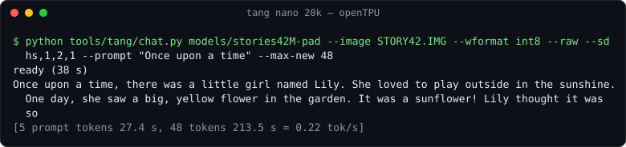
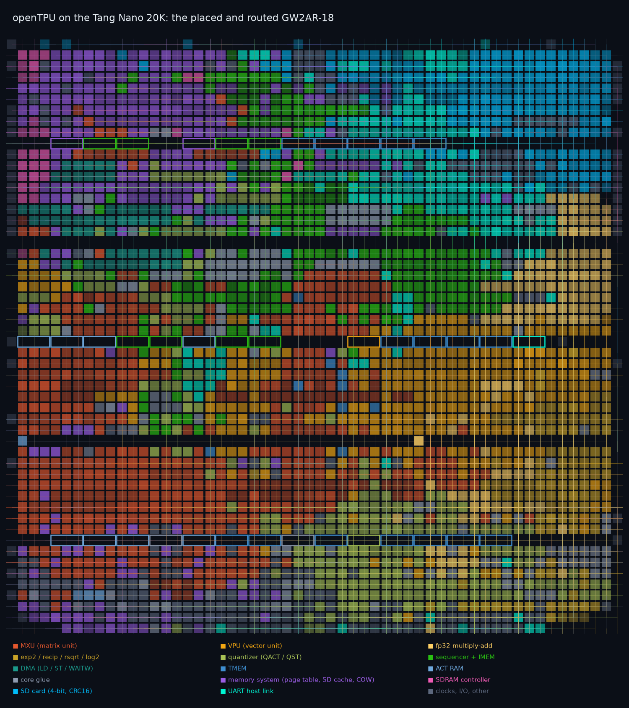

# openTPU on a $25 FPGA: Tang Nano 20K

A port of [openTPU](https://github.com/FeSens/openTPU) (an open-source AI accelerator: ISA,
bit-exact simulator, compiler, RTL) to the **Sipeed Tang Nano 20K**, a small Gowin GW2AR-18 board
with 20K LUTs, 46 block RAMs and 8 MiB of SDRAM. It runs real language models with their
weights **streamed from the SD card**, and produces the ISA simulator's results **bit for bit**.



**Project site:** `site/` (GitHub Pages: an interactive map of the placed and routed FPGA, the
board's logs replayed, how it works). Locally: `python -m http.server -d site`.

| model | weights | image on the card | on the board | tokens |
|:--|:--|--:|--:|:--|
| stories42M (llama2.c, TinyStories) | int8 | 47 MiB | 0.22 tok/s | 48 / 48 = ISA simulator, 47 / 48 = Hugging Face fp32 |
| SmolLM2-135M-Instruct | fp4, int8 head | 100 MiB | 0.08 tok/s | "The capital of France is Paris. It is a city that is known for its" |
| SmolLM2-360M-Instruct | fp4, int8 head | 239 MiB | — | ISA simulator: 8 / 8 = Hugging Face, "The capital of France is Paris." |

*Measured on the board on 2026-10-18 (Tang Nano 20K, an SDHC card in 48 MHz high-speed mode,
the core at 48 MHz). Every token reads the whole image from the card, so a token takes the
image size over ~10.9 MB/s. Logs: [examples/tangnano20k/results](examples/tangnano20k/results).*



*Where nextpnr put the design on the GW2AR-18 (`tools/tang/site_data.py`, from the bitstream's
placement): the MXU in red, the VPU in orange, the sequencer in green, the memory system in
purple, the SD card reader in blue; the outlined blocks are the block RAMs.*

## What is here

- **A new core** (`rtl/lite`) for openTPU's ISA that fits 83% of the FPGA: one shared fp32
  multiply-add pipeline does every VOP and the composite functions; MM accumulates exactly in
  integers, four rows at a time. The original microarchitecture needs five times this FPGA.
- **A memory system** (`rtl/boards/tangnano20k`) that turns an image file on the SD card plus
  the SDRAM into a 1 GiB DRAM: a page table, a 16-line cache of 64 KiB SD reads, copy-on-write
  pages for everything the program writes. The card is never written.
- **An SD card reader** in native 4-bit mode, 24 MHz or 48 MHz high speed, that checks every
  block's CRC16 and restarts reads the card got wrong or stalled on.
- **A UART host link** (2 Mbaud through the on-board BL616) and the host side
  (`opentpu/host/tang.py`): the Engine backend, FAT16/32/exFAT image lookup, the on-board
  generate loop.
- **A virtual board** (`sim/tang`, Verilator): the whole board RTL with SDRAM and SD card
  models, its UART on a TCP socket, so everything runs without hardware.
- **Tools** (`tools/tang`): bitstream build, SD images, bring-up checks, SD bus tuning, chat.

Details: [docs/tangnano20k.md](docs/tangnano20k.md). Step by step:
[examples/tangnano20k](examples/tangnano20k/README.md).

## Quick start

```sh
pip install -e .
openFPGALoader -b tangnano20k boards/tangnano20k/prebuilt/tang_top.fs       # load the bitstream (SRAM)

hf download HuggingFaceTB/SmolLM2-135M-Instruct --local-dir models/SmolLM2-135M-Instruct
python tools/tang/sdimage.py models/SmolLM2-135M-Instruct --wformat fp4 --head-format int8 --out SMOL135.IMG
# copy SMOL135.IMG to a freshly formatted FAT16/FAT32/exFAT card, insert it

python tools/tang/bringup.py --port COM6 --image SMOL135.IMG --speed
python tools/tang/sdtune.py  --port COM6        # the card's high-speed settings, e.g. --sd hs,1,2,1
python tools/tang/chat.py models/SmolLM2-135M-Instruct --port COM6 --image SMOL135.IMG \
    --wformat fp4 --head-format int8 --sd hs,1,2,1
```

Without a board: `bash sim/tang/build.sh && python tools/tang/board_sim_test.py`.

## Verified

- Random ISA programs on the RTL against the simulator, bit for bit (`tools/tang/cosim.py`):
  every VOP, the reductions, QACT / QST, MM in int8 / int4 / fp4 / nvfp4.
- A SmolLM2-shaped network on the RTL, and small models through the whole virtual board
  (`model_cosim.py`, `board_sim_test.py`): the logits bit for bit, also with the card model
  stalling and corrupting blocks.
- On the board: bring-up, an ISA softmax bit-exact against the simulator
  (`examples/tangnano20k/softmax_isa.py`), and the chats above.

## Limits

The on-chip memory decides which models fit: TMEM (8K words) holds hidden sizes up to ~1K, IMEM
512 instructions. TinyLlama-1.1B and Qwen3-0.6B need about twice the TMEM the FPGA has;
stories110M's decode step is 583 instructions. head_dim, hidden and FFN must be multiples of 64
(`tools/tang/pad_ffn.py` zero-pads an FFN). GPT-Neo models (TinyStories-1M/33M) are not
supported by the compiler. [docs/tangnano20k.md](docs/tangnano20k.md#which-models-fit).

## Credits and license

Based on [FeSens/openTPU](https://github.com/FeSens/openTPU) (Apache-2.0): its ISA, simulator,
compiler, kernels, model code and fp32 units are used here. This port adds `rtl/lite`,
`rtl/boards/tangnano20k`, `sim/lite`, `sim/tang`, `tools/tang`, `opentpu/host/tang.py`,
`targets/tangnano20k.toml`, `boards/tangnano20k`, `examples/tangnano20k` and this README, and
changes `opentpu/llm/qwen3.py` (per-head query projection for a small TMEM; relaxed shape
checks). The original README is [README.openTPU.md](README.openTPU.md). Apache-2.0, see
[LICENSE](LICENSE).
